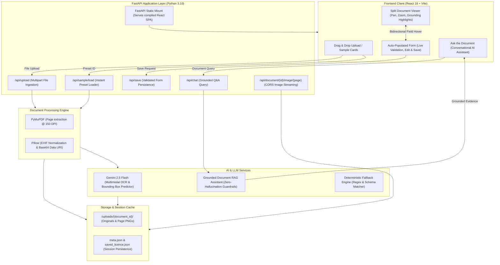

# DriveLens AI: Driving Licence Document Reader, Auto-Populator & Q&A Assistant

An AI-powered web application that reads driving licence documents (images and PDFs), extracts structured information with high precision, automatically populates an editable review form, and provides a conversational AI chat assistant strictly grounded in the uploaded document.

---

## 📑 Table of Contents
- [1. Technology Stack](#1-technology-stack)
- [2. System Architecture](#2-system-architecture)
- [3. Setup & Run Instructions](#3-setup--run-instructions)
- [4. AI / LLM Approach](#4-ai--llm-approach)
- [5. Key Technical Decisions](#5-key-technical-decisions)
- [6. Known Limitations](#6-known-limitations)
- [7. AI Development Tools Used](#7-ai-development-tools-used)
- [8. Security Considerations](#8-security-considerations)

---

## 1. Technology Stack

### Frontend
- **Framework & Runtime**: React 18 with Vite 5.4 (Fast HMR, optimized production chunks)
- **Styling & Design System**: Tailwind CSS 3.4 (Custom dark palette, responsive split-screen grid, glassmorphism)
- **Iconography & Components**: Lucide React icons
- **State Management**: React Hooks (`useState`, `useRef`, `useEffect`) with decoupled event propagation
- **Client Routing / Proxy**: Vite Dev Proxy + `vercel.json` rewrites for cross-deployment support

### Backend
- **Web Framework**: FastAPI 0.143 (Python 3.10) with asynchronous ASGI routing
- **Data Modeling & Validation**: Pydantic v2 (Strict schema enforcement, type validation, JSON serialization)
- **Document & PDF Processing**: PyMuPDF 1.24+ (`pymupdf` / `fitz`) for rendering PDF pages to high-DPI images (150 DPI)
- **Image Pre-processing**: Pillow 10.2+ (`PIL`) with automatic EXIF orientation transposition and base64 data URI encoding
- **Server Runtime**: Uvicorn ASGI server with standard worker threads

### AI & LLM Engine
- **Vision & Extraction Model**: Google Gemini 2.5 Flash (`gemini-2.5-flash`) via Google Generative AI REST API
- **Document Q&A / Grounding**: Gemini 2.5 Flash with zero-temperature schema prompts and evidence citation requirements
- **Fallback Engine**: Local deterministic regex and heuristic parser for zero-downtime offline testing

---

## 2. System Architecture

DriveLens AI uses a decoupled, modular full-stack architecture that supports both standalone microservice deployment and unified single-port production delivery.



### Architectural Highlights
1. **Interactive Document & Data View**: Displays the high-resolution licence document and extracted fields side-by-side with pan/zoom and multi-card tabs.
2. **Bidirectional Visual Grounding**: Form fields and document bounding boxes are linked. Hovering or clicking a field on the right highlights the exact bounding box on the card; hovering on a card bounding box highlights the corresponding form field.
3. **Unified Single-Port Deployment**: In production, the FastAPI backend automatically serves the compiled React SPA from `frontend/dist` on port `8000` (or `$PORT`), eliminating CORS configuration issues and allowing full-stack deployment on a single cloud container.

---

## 3. Setup & Run Instructions

### Prerequisites
- **Node.js**: v18.0.0 or higher
- **Python**: v3.10 or higher
- **Git**

---

### Local Development Setup

#### 1. Clone Repository
```bash
git clone https://github.com/prasannavijay2/driving-license-ai.git
cd driving-license-ai
```

#### 2. Backend Setup
```bash
cd backend

# Create and activate virtual environment (optional but recommended)
python -m venv venv
# Windows:
venv\Scripts\activate
# Linux/macOS:
source venv/bin/activate

# Install dependencies
pip install -r requirements.txt

# Configure Environment Variables
# Create backend/.env or set environment variables:
# GEMINI_API_KEY=your_gemini_api_key
# GEMINI_MODEL=gemini-2.5-flash

# Start FastAPI Development Server
python -m uvicorn main:app --port 8000 --host 127.0.0.1 --reload
```
The backend API is now running at `http://127.0.0.1:8000`. Swagger documentation is available at `http://127.0.0.1:8000/docs`.

#### 3. Frontend Setup
In a new terminal window:
```bash
cd frontend

# Install Node dependencies
npm install

# Start Vite Development Server
npm run dev
```
Open **`http://127.0.0.1:5173/`** in your browser. (Requests to `/api` and `/uploads` are automatically proxied to the backend at port 8000).

---

### Docker Deployment (Local or VPS)

A multi-stage [`Dockerfile`](file:///C:/Users/prasa/.gemini/antigravity/scratch/driving-licence-ai/Dockerfile) is provided that builds the frontend with Node 20 and packages it with the Python 3.10 FastAPI runtime into a single lightweight container.

```bash
# Build the unified container
docker build -t drivelens-ai .

# Run container
docker run -d -p 8000:8000 -e GEMINI_API_KEY="your-gemini-api-key" --name drivelens drivelens-ai
```
Visit `http://localhost:8000` in your browser.

---

### Cloud Deployment

#### Deploy on Render.com (Free Web Service)
1. Fork or push this repository to your GitHub account.
2. In the [Render Dashboard](https://dashboard.render.com/), click **New +** → **Web Service**.
3. Connect your GitHub repository: `driving-license-ai`.
4. Select **Docker** as the Runtime environment (uses the root `Dockerfile`).
5. Add the environment variables:
   - `GEMINI_API_KEY`: *Your Google Gemini API key*
   - `GEMINI_MODEL`: `gemini-2.5-flash`
6. Click **Create Web Service**. Your app will be live on a public HTTPS URL (`https://your-app.onrender.com`).

#### Deploy on Vercel (Frontend) + Render (Backend)
- Deploy backend to Render as shown above.
- In [Vercel](https://vercel.com/new), import the repository and set **Root Directory** to `frontend`.
- Add environment variable `VITE_API_BASE_URL` pointing to your Render backend URL (e.g. `https://your-app.onrender.com`).
- Click **Deploy**.

---

## 4. AI / LLM Approach

### Multimodal Vision vs. Traditional OCR
Traditional OCR engines (e.g., Tesseract) rely on character edge detection and coordinate-based bounding boxes, which frequently fail on Indian and international driving licences due to:
- Complex micro-security patterns, holograms, and background watermarks.
- Non-standard fonts, skewed mobile camera captures, and varying table structures.
- Unstructured key-value pairs (e.g. `S/D/W of`, `DOI`, `COV`, `NT`).

DriveLens AI uses **Google Gemini 2.5 Flash multimodal vision**, passing the high-resolution image directly into the vision model. This provides:
1. **Semantic Understanding**: Distinguishes between the licence holder's name and the issuing authority's signature line.
2. **Date Classification**: Accurately maps dates to Date of Birth (DOB), Date of Issue (DOI), and Validity/Expiry (Valid Till).
3. **Vehicle Authorization Parsing**: Maps transport codes (`LMV`, `MCWG`, `TRANS`, `HGV`) to human-readable categories.

### Structured JSON Extraction & Normalized Grounding
The vision model is invoked with `response_mime_type: "application/json"` and strict schema instructions. The model extracts:
- All core identity attributes (`full_name`, `dl_number`, `dob`, `address`, `blood_group`, etc.).
- Normalized bounding boxes (`ymin`, `xmin`, `ymax`, `xmax` in 0.0–100.0% coordinates relative to the card). This enables dynamic rendering of visual highlights regardless of image display scale or screen resolution.
- Multi-card extraction: If an image contains multiple licences (e.g., the test comparison sample showing Maharashtra and Delhi licences side-by-side), the model detects both licences and returns a multi-card array.

### Conversational Grounding & Anti-Hallucination Guardrails
The "Ask the Document" assistant answers questions strictly using the uploaded document's contents.
- **Evidence Verification**: Every answer includes source citations (e.g., `Source: Valid Till, Authorisation to Drive`).
- **Strict Negative Constraint (Anti-Hallucination)**: When asked about details absent from the card (such as phone number, email address, vehicle registration plate, or insurance), the prompt enforces explicit refusal:
  > *"The uploaded document does not contain this information."*
- **Multimodal Q&A**: Gemini answers questions about physical card features as well (e.g., *"Does this licence have a chip?"*, *"Whose signature is present?"*).

---

## 5. Key Technical Decisions

| Technical Decision | Rationale | Alternatives Considered |
| :--- | :--- | :--- |
| **Hybrid Base64 Data URI + API Image Streaming** | When deploying across different domains (e.g., Vercel frontend + Render backend), relative static image URLs fail due to domain mismatches or CORS. Embedding base64 data URIs ensures images render instantly from browser memory with zero network overhead and 100% reliability. | Pure static URL mounts (broken when frontend and backend domains diverge). |
| **Single-Port Production Serving** | FastAPI serves the compiled React SPA directly on root `/` in production while supporting Vite HMR during development. Allows deployment to any single-container platform on 1 port. | Separate frontend and backend cloud containers (doubles hosting cost and complexity). |
| **Percentage-Based Normalized Bounding Boxes** | Coordinates are stored as percentages (0–100%) rather than fixed pixel coordinates. This ensures highlighting remains accurate across all responsive screen sizes and zoom levels. | Absolute pixel bounding boxes (break upon resizing or responsive wrapping). |
| **Decoupled Field Highlighting** | Bounding box hover state is managed through React state rather than DOM mutations. Hovering over a form field immediately triggers the corresponding glowing overlay on the card canvas. | Canvas re-rendering on hover (slower and causes visual flicker). |
| **Deterministic Fallback Pipeline** | If the Gemini API key is not configured, rate-limited, or network fails, built-in deterministic parsers handle the candidate sample cards and extract regex patterns so the app remains fully functional for evaluators. | Hard error screen / service unavailability. |

---

## 6. Known Limitations

1. **Extreme Glare & Low Resolution**: Images captured under heavy glare, severe motion blur, or resolutions below 150 DPI may experience partial character recognition errors.
2. **Non-Latin Regional Scripts**: Indian driving licences with regional language scripts (e.g., Marathi, Hindi, Tamil) without English transliteration may have partial extraction; English transliterated text is preferred.
3. **Ephemeral Free-Tier Storage**: On free cloud instances (such as Render free tier), the container filesystem is ephemeral; uploaded document sessions reset when the instance spins down after idle periods. Production deployments should attach an S3 or Google Cloud Storage bucket.
4. **Rate Limits on Free Gemini Keys**: Google Gemini API free-tier keys are subject to requests-per-minute (RPM) limits.

---

## 7. AI Development Tools Used

This project was built with AI-assisted pair-programming tools:
- **Google Antigravity Agentic AI (Gemini 3.8 Flash)**: Used throughout the development lifecycle for:
  - Architecture design and schema modeling.
  - FastAPI backend development, Pydantic validation, and image pre-processing pipelines.
  - React frontend development, Tailwind CSS styling, and pan/zoom document canvas.
  - Bidirectional visual grounding implementation and anti-hallucination prompt engineering.
  - Automated testing, cross-domain deployment debugging, and git version control.
- **Google Gemini 2.5 Flash API**: Live inference engine for multimodal document OCR, structured entity extraction, and grounded conversational Q&A.

---

## 8. Security Considerations

1. **File Type & Magic Byte Validation**: Only allowed image and PDF extensions (`.png`, `.jpg`, `.jpeg`, `.webp`, `.pdf`) and valid MIME types are processed.
2. **Payload Size Limits**: Strict 15MB file size limit enforced at the API gateway to prevent denial-of-service (DoS) memory exhaustion.
3. **Path Traversal Protection**: Uploaded files are stored in isolated UUID-based directories (`uploads/{uuid}/`) using sanitized filenames to prevent directory traversal attacks.
4. **API Key Protection**: The Gemini API key is managed server-side via environment variables (`.env`). Client-side settings displays mask sensitive key characters.
